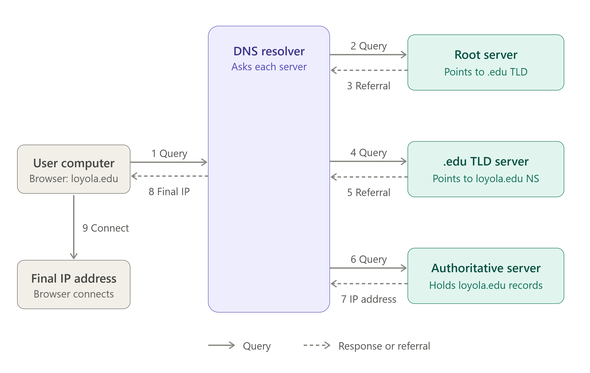

Cookies are small bits of data that websites save in your browser so they can remember who you are. Most of the time they hold a unique ID that keeps you logged in, along with settings like your language, dark mode, or what's in your shopping cart. They also often include tracking IDs from advertisers and analytics companies, which let them recognize your browser over time and build a picture of your interests and habits. Cookies usually don't store your actual password or personal details, since the real information stays on the website's servers and the cookie just points to it. They can still be a privacy and security risk, though, because a stolen login cookie can let someone take over your session, and third-party tracking cookies can follow you from site to site.

Root Servers 

1. **Local check:** The user types `loyola.edu` into the browser. The computer checks the browser cache, the OS cache, and the hosts file. If an IP address is found, the lookup ends here.
2. **Query to the resolver:** If there is no cached answer, the computer sends a recursive query to its DNS resolver (usually provided by the ISP or a public service like 8.8.8.8).
3. **Query to the root server:** The resolver asks a root server where to find `loyola.edu`.
4. **Root referral:** The root server replies with the addresses of the `.edu` TLD name servers.
5. **Query to the TLD server:** The resolver asks the `.edu` TLD server about `loyola.edu`.
6. **TLD referral:** The TLD server replies with the authoritative name servers for `loyola.edu`.
7. **Query to the authoritative server:** The resolver asks the `loyola.edu` authoritative server for the website's address.
8. **Authoritative answer:** The authoritative server returns the IP address (an A or AAAA record) along with a TTL that says how long the answer can be cached.
9. **Return to the user:** The resolver caches the answer and sends the IP address to the user's computer. The browser then connects to that IP address.

IP Network Design

